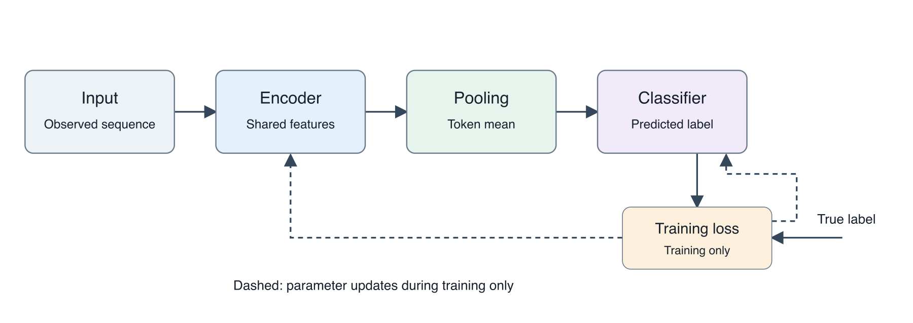

# PaperBanana for Codex

A Codex skill for scientific figures that remain understandable and editable: reference-guided planning, source-grounded diagrams, data-derived plots, local SVG/PNG/PDF exports and visual revision checks.

**Runs within your existing Codex session. No separate model API key or billed API calls.** Codex subscription limits still apply. Free local export libraries do not generate scientific content or verify its truth.

This is an independent adaptation, not the official PaperBanana runtime. It incorporates useful mechanisms from related projects without shipping their inference code or claiming their benchmark scores. See the [comparison and evidence](docs/comparison.md).



## Install

Requires Node.js 20.9+ with npm, Python 3 for the installer, and Codex with local file execution. Dependencies are pinned in `package-lock.json`; installation downloads free open-source packages. Scientific figure reasoning runs in Codex, while the helpers render/export locally.

```sh
git clone https://github.com/nazeeh111/paperbanana-codex.git
cd paperbanana-codex
npm ci
npm test
python3 scripts/install.py
```

The installer copies the skill and its dependencies into `~/.codex/skills/paperbanana`. It refuses to overwrite an existing directory or symlink. To select another discoverable skill directory:

```sh
python3 scripts/install.py --dest /your/skill-root/paperbanana
```

The skill should be available on the next turn; restart Codex if its skill list does not refresh. It enables normal automatic selection for scientific figure requests and supports explicit invocation:

> Use $paperbanana to turn these methods and this caption into an editable scientific figure. Render it, inspect it and provide the SVG and PDF.

For upgrades, preserve any local changes, move the existing installation to a backup, then install the new version. Restoring that backup restores the previous skill. The installer never overwrites your work. `node_modules` is platform-specific: use `npm ci` on each target operating system; do not move a dependency installation between systems.

## What it does

- Reads source methods, captions, data and references before drawing.
- Maps scientific relationships to stable, editable SVG objects.
- Keeps quantitative plots tied to actual data and generating code.
- Preserves accepted decisions across revisions through a compact requirements ledger.
- Separates vector, hybrid and raster output honestly.
- Inspects fresh rendered images for fidelity, text, arrow directions, clipping and final-size readability.
- Keeps the last accepted version until the replacement is checked.

These are workflow instructions to Codex, not a standalone model or autonomous figure generator. Renderer tests do not demonstrate universal scientific or aesthetic quality. General app UI and routine software architecture requests retain their own workflows.

## Local export tools

From the installed skill directory, or from this checkout:

```sh
node scripts/svg.cjs figure.svg
node scripts/render_svg.cjs figure.svg preview-v1.png --width 2103
node scripts/export_pdf.cjs figure.svg figure-v1.pdf --width-mm 178
```

The PNG example is approximately 300 pixels per inch at 178 mm. Choose width and resolution from the actual venue requirements. SVG is the editable master; the PDF exporter preserves vector shapes and text for its supported SVG subset. Embedded raster assets remain raster in a hybrid PDF.

The helpers refuse existing outputs, reject external resources, active content, duplicate IDs and missing internal references, and bound PNG dimensions. These checks are not a security sandbox for hostile files. Use authored or inspected figures.

The PDF exporter rejects filters, masks, patterns and style sheets and fails on its own reported warnings. It does not implement all SVG/CSS features. Use inline styles/basic geometry or a different verified exporter when needed. Font substitution, mathematical glyphs, complex scripts and renderer differences require inspection of the actual PDF. A valid file header does not prove a correct figure.

Raster reconstruction can make labels, arrows and ordinary shapes editable. Complex illustration crops can remain bitmaps, in which case output is **hybrid**, not fully vector. Model-assisted raster generation uses an available subscription image tool only; no hidden provider fallback is configured.

## Examples and verification

```sh
npm test
npm run examples
```

Tests use fresh temporary directories, need no model calls and cover SVG validation, successful PNG content, output preservation, resource rejection, projected dimensions, PDF structure/size, hybrid classification and exact example plot coordinates. Examples generate editable SVG, PNG and PDF with explicit source briefs and synthetic plot data. See [validation](docs/validation.md) for tested scope and limits.

[Example source and caption](examples/brief.md) · [Editable method SVG](examples/rendered/method.svg) · [Method PDF](examples/rendered/method.pdf) · [Synthetic plot](examples/rendered/plot.png)

## Attribution and license

Apache-2.0; see [LICENSE](LICENSE) and [NOTICE](NOTICE). Inspired by [PaperBanana](https://github.com/dwzhu-pku/PaperBanana) and [its paper](https://arxiv.org/abs/2601.23265), with additional design references documented in the comparison. Not affiliated with or endorsed by the upstream authors. No upstream models, datasets, icons or benchmark figures are redistributed.
